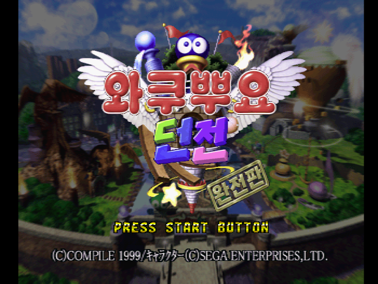
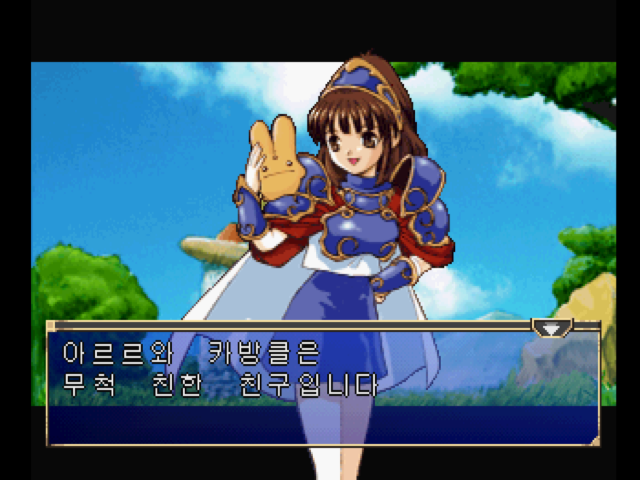
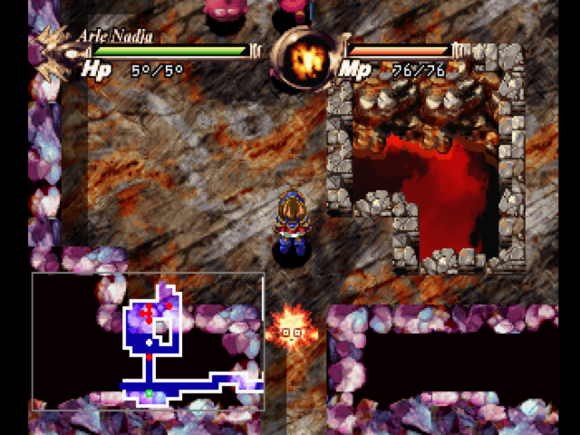

# 와쿠와쿠 뿌요뿌요 던전 완전판 — PlayStation

[전체 마도물어 한글 패치 목록으로 돌아가기](../README.md)

PlayStation용 《와쿠와쿠 뿌요뿌요 던전 완전판》 일본판 한글 번역 패치입니다.

> **정식 배포 (v1.0.0)**







## 적용 방법

1. 아래 체크섬과 일치하는 일본판 원본 BIN/CUE를 준비합니다
2. [Waku Puyo Dungeon - Ketteiban (PlayStation) KR v1.0.0.xdelta](<https://raw.githubusercontent.com/mcpads/madou-monogatari-kr-patch/main/ps1-waku-puyo/Waku%20Puyo%20Dungeon%20-%20Ketteiban%20(PlayStation)%20KR%20v1.0.0.xdelta>)를 다운로드합니다
3. `xdelta3` 등 xdelta 호환 패처로 원본 BIN에 한글 패치를 적용합니다
4. 패치 결과 BIN의 파일명을 원본 CUE의 `FILE` 행에 맞추거나, `FILE` 행을 결과 BIN 이름으로 변경합니다

```sh
xdelta3 -d -s "Waku Puyo Dungeon - Ketteiban (Japan).bin" "Waku Puyo Dungeon - Ketteiban (PlayStation) KR v1.0.0.xdelta" "Waku Puyo Dungeon - Ketteiban (PlayStation) KR v1.0.0.bin"
```

## 체크섬

| 구분 | SHA-256 |
| --- | --- |
| 원본 BIN | `b27697f765658c7b5ef7fb795edc5418cb072f4eaacf275c1fce6fb01c919bc2` |
| 패치 | `bde7fec55b038b7ce3d2e7b49b835eb89e2555bfc6d76f08375305994010db3c` |

## 패치 정보

- 일본판 단일 BIN에 직접 적용하는 xdelta 패치
- 게임 내 텍스트와 그래픽 한글화
